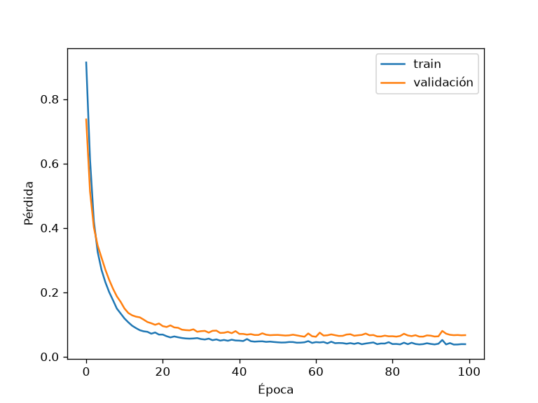

# Pipeline Base – Clasificación con PyTorch

Pipeline de entrenamiento y validación sobre el dataset Iris con un MLP (4 → 16 → 3).

## Ejecución
    pip install -r requirements.txt
    python src/train.py

## Configuración
- Versión de PyTorch: 2.14.1+cpu
- Dispositivo: detección automática (CUDA / MPS / CPU); en esta corrida, CPU
- Optimizador: Adam
- learning_rate: 0.01
- Pérdida: CrossEntropyLoss
- Épocas: 100, batch size 16
- Split: 80% entrenamiento / 20% validación (estratificado)

## Resultados (época 100)
- Pérdida de entrenamiento: 0.0387
- Pérdida de validación: 0.0667
- Accuracy de validación: 0.967

## Interpretación de la curva de pérdida
La pérdida bajó de forma sostenida durante el entrenamiento: en train pasó de 0.9135
a 0.0387 y en validación de 0.7366 a 0.0667. Ambas curvas descienden juntas y quedan
cerca, lo que indica que el modelo aprende sin sobreajustar de forma evidente. Desde
la época 50 aproximadamente la curva se aplana. El accuracy de validación se mantuvo
entre 0.967 y 1.000; con solo 30 muestras de validación, un error cambia el valor
en 3.3 puntos porcentuales.

